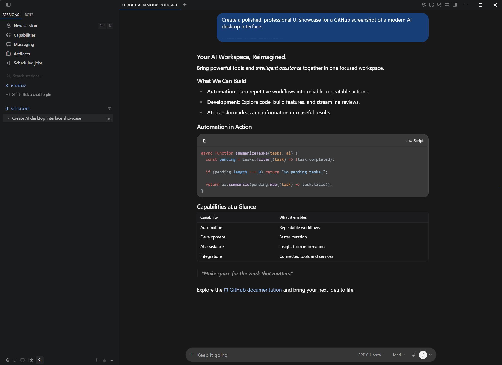

# Hermes GPT Dark Theme

**Bring the ChatGPT experience to Hermes Desktop.**

A carefully crafted, ChatGPT-inspired interface featuring blue user-message bubbles, a focused conversation layout, refined typography, and clean code blocks.

> Independent community project. Not affiliated with or endorsed by Nous Research or OpenAI.

## Preview



## Features

- Rounded blue message bubbles for user messages (`#173E76`)
- Copy button below user messages
- Dark conversation and sidebar surfaces (`#181818` / `#1A1B1D`)
- Clear section labels and readable links
- Centered `780px` conversation column
- **Segoe UI**, `16px` main text with `26px` line height
- **Consolas**, `13px` code text
- Refined fenced-code blocks with an available-language label and native copy control
- Theme selection on initial installation, respecting later user preferences

## Install from Git

In **Hermes Desktop**, open **Capabilities → Plugins → Install from Git** and enter:

```text
shezoncom/hermes-gpt-dark-theme
```

Review the source and confirm installation. To choose the theme manually, open **Settings → Appearance → Theme** and select **Hermes GPT Dark Theme**.

## Manual installation

Close Hermes Desktop, then copy [`desktop/plugin.js`](desktop/plugin.js) to a folder named `hermes-gpt-dark-theme` inside your local `desktop-plugins` directory.

On Windows, the destination is:

```text
%LOCALAPPDATA%\hermes\desktop-plugins\hermes-gpt-dark-theme\plugin.js
```

Open Hermes Desktop again. If you previously disabled the plugin, re-enable it from **Capabilities → Plugins**. You can also use **Hermes GPT Dark Theme: Apply** in the command palette (`Ctrl+K`).

Avoid running two desktop plugins that modify the same chat layout at the same time.

## Compatibility

Tested on Windows. macOS and Linux have not yet been verified. This plugin extends the Hermes Desktop UI; changes to the application's internal markup may affect compatibility.

## Privacy

The plugin does not include telemetry or outbound network requests. Its copy control accesses the clipboard only when invoked. Review third-party plugin code before installation; Hermes Desktop plugins are not sandboxed.

## License

[MIT](LICENSE).
